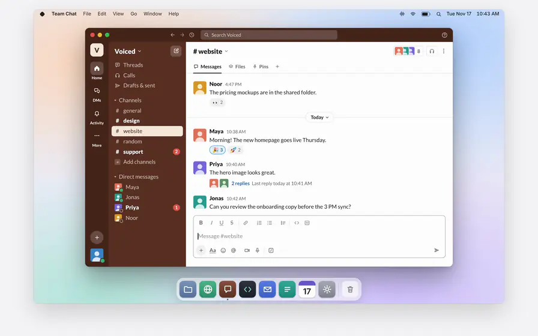

# Voiced

Hold a key, speak, and your words appear, cleaned up, in whatever app you are typing in.



Voiced in use in four apps. The pill is the app's own and sits by the text you are typing, as it does by default; it can be set to stay in one place instead. The desktop and the apps are mock-ups made for the film, and the line under the screen shows what is being said, because the film has no sound.

Voiced is a native macOS menu bar app for dictation, written in Swift and SwiftUI. While you hold a hotkey it streams your voice to the SpaceXSI API for transcription, has a Grok model tidy the transcript, and pastes the result where your cursor is. Download it, or build it yourself from this repository, and use it with your own SpaceXSI API key.

It needs macOS 26 or later, your own SpaceXSI API key, which SpaceXSI bills for what you dictate, and a network connection for every dictation. It does not transcribe on the Mac or offline, keeps no history, and has no custom dictionary or language setting.

Why it exists: the [launch post](https://x.com/ericzakariasson/status/2123825984231362902) on X.

Voiced is inspired by Wispr Flow. It is an independent project, not affiliated with or endorsed by Wispr or SpaceXSI.

## Fork it and change it

[`AGENTS.md`](AGENTS.md) tells a coding agent how to build, test, run and change Voiced. Hand your agent this, with your own request at the end:

```text
Clone https://github.com/ericzakariasson/voiced, read AGENTS.md at its root and follow its First run section, then make this change: <what you want changed>
```

[Changes people often ask for](AGENTS.md#changes-people-often-ask-for) says where each one starts.

## Install

Download the latest DMG from [Releases](https://github.com/ericzakariasson/voiced/releases/latest), open it, and drag Voiced into Applications. You need macOS 26 or later.

A download whose name ends in `-unsigned` is not signed with an Apple Developer ID. macOS will not open it until you click Open Anyway under System Settings › Privacy & Security, and each update has to be approved, and given Accessibility, again. The release's notes have the steps.

Or build it, with Xcode 26.2 or later:

```sh
git clone https://github.com/ericzakariasson/voiced.git
cd voiced
make run
```

Either way a setup window opens. Allow the microphone, switch Voiced on under Accessibility, and paste your key. Then click into any text field, hold **Right ⌥ (Option)**, speak, and release.

More: [using Voiced](docs/using-voiced.md), [troubleshooting](docs/troubleshooting.md), [building, signing and tests](docs/building.md), and [releasing](docs/releasing.md).

## Your Grok API key

That is what Voiced calls your SpaceXSI API key. Create one at [console.x.ai](https://console.x.ai) and paste it into the setup window. It is kept in your login Keychain, never in a file or a log, and sent only to `api.x.ai`. SpaceXSI bills that key's account for what you dictate.

## Privacy

- Voiced talks to one host, `api.x.ai`: your voice while you hold the hotkey, and the transcript for cleanup when you release it. With Cleanup switched off, only your voice is sent. No analytics, crash reporting, update check or other server.
- It keeps no audio and no transcripts. The microphone is on from when the hotkey goes down until just after you release it, and at no other time.
- A global hotkey means seeing every key press. Voiced uses them to recognise the hotkey and for nothing else.
- With the pill set to Next to Text, which is the default, it asks the app in front where its text or its window is on screen, never what the text says. An app built on Electron or Chromium answers only once its accessibility support is on, so Voiced switches that on, once per app. With the pill set to Fixed Place, it asks other apps nothing.

Every request, permission and log field: [Permissions and privacy](docs/privacy.md).

## About this repository

Voiced is developed in a private working repository, and this one gets one commit from it for each release, and now and then one between releases that changes only the documentation. So the history here is a list of versions, not of changes to the app, and each release's commit holds the whole of that release.

## License

[MIT](LICENSE). Copyright (c) 2026 Eric Zakariasson.
