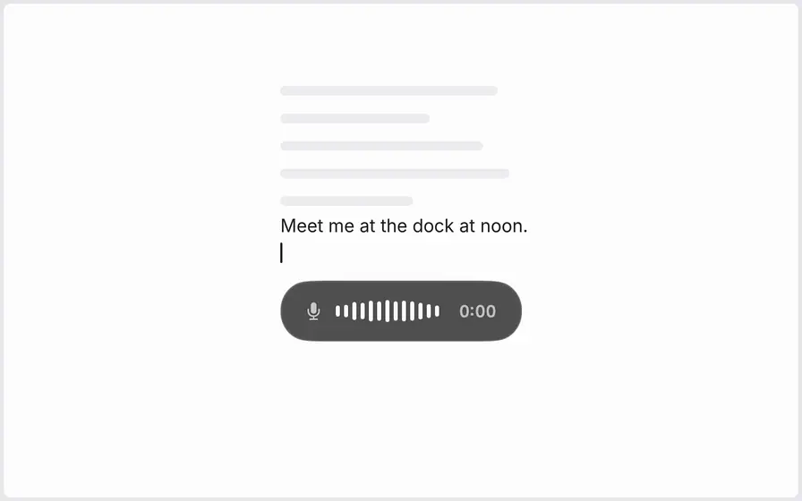

# Voiced

> it's fun building your own malleable software. as coding agents get better, anyone can do it, but it will still require understanding the problem!
>
> many off-the-shelf products will be recreated and replaced by custom software. that also means a lot of duplication, which maybe isn't necessary! if we open source instead, people with the same problems can build on top, and it compounds. my guess is a lot of it ends up free
>
> one of those is dictation and voice prompting. it's become my default way to express intent so i built this small tool
>
> powered by grok voice, open source, yours to fork



The film has sound in the [launch post on X](https://x.com/ericzakariasson/status/2123825984231362902).

Voiced is remixable software: a small dictation app for macOS that is meant to be forked and changed. The whole app is here under the [MIT license](LICENSE), with [`AGENTS.md`](AGENTS.md) for a coding agent to work from, and the forks in the film are examples of what an agent could make of it: none of those changes are in Voiced itself. As it comes, you hold a key, speak, and your words appear, cleaned up, in whatever app you are typing in.

## Fork it and change it

[`AGENTS.md`](AGENTS.md) tells a coding agent how to build, test, run and change Voiced. Hand your agent this, with your own request at the end:

```text
Clone https://github.com/ericzakariasson/voiced, read AGENTS.md at its root and follow its First run section, then make this change: <what you want changed>
```

[Changes people often ask for](AGENTS.md#changes-people-often-ask-for) says where each one starts.

## What it does

Voiced is a native macOS menu bar app for dictation, written in Swift and SwiftUI. While you hold a hotkey it streams your voice to the SpaceXSI API for transcription, has a Grok model tidy the transcript, and pastes the result where your cursor is. Download it, or build it yourself from this repository, and use it with your own SpaceXSI API key.

It needs macOS 26 or later, your own SpaceXSI API key, which SpaceXSI bills for what you dictate, and a network connection for every dictation. It does not transcribe on the Mac or offline, keeps no history, and has no custom dictionary or language setting.

## Install

Download the latest DMG from [Releases](https://github.com/ericzakariasson/voiced/releases/latest), open it, and drag Voiced into Applications. You need macOS 26 or later.

A download whose name ends in `-unsigned` is not signed with an Apple Developer ID. macOS will not open it until you click Open Anyway under System Settings › Privacy & Security, and each update has to be approved, and given Accessibility, again. The release's notes have the steps.

Or build it, with Xcode 26.2 or later:

```sh
git clone https://github.com/ericzakariasson/voiced.git
cd voiced
make run
```

Either way a setup window opens. Allow the microphone, switch Voiced on under Accessibility, and paste your key. Then click into any text field, hold **Right ⌥ (Option)**, speak, and release.

More: [using Voiced](docs/using-voiced.md), [troubleshooting](docs/troubleshooting.md), [building, signing and tests](docs/building.md), and [releasing](docs/releasing.md).

## Your Grok API key

That is what Voiced calls your SpaceXSI API key. Create one at [console.x.ai](https://console.x.ai) and paste it into the setup window. It is kept in your login Keychain, never in a file or a log, and sent only to `api.x.ai`. SpaceXSI bills that key's account for what you dictate.

## Privacy

- Voiced talks to one host, `api.x.ai`: your voice while you hold the hotkey, and the transcript for cleanup when you release it. With Cleanup switched off, only your voice is sent. No analytics, crash reporting, update check or other server.
- It keeps no audio and no transcripts. The microphone is on from when the hotkey goes down until just after you release it, and at no other time.
- A global hotkey means seeing every key press. Voiced uses them to recognise the hotkey and for nothing else.
- With the pill set to Next to Text, which is the default, it asks the app in front where its text or its window is on screen, never what the text says. An app built on Electron or Chromium answers only once its accessibility support is on, so Voiced switches that on, once per app. With the pill set to Fixed Place, it asks other apps nothing.

Every request, permission and log field: [Permissions and privacy](docs/privacy.md).

## About this repository

Voiced is inspired by Wispr Flow. It is an independent project, not affiliated with or endorsed by Wispr or SpaceXSI.

Voiced is developed in a private working repository, and this one gets one commit from it for each release, and now and then one between releases that changes only the documentation. So the history here is a list of versions, not of changes to the app, and each release's commit holds the whole of that release.

## License

[MIT](LICENSE). Copyright (c) 2026 Eric Zakariasson.
